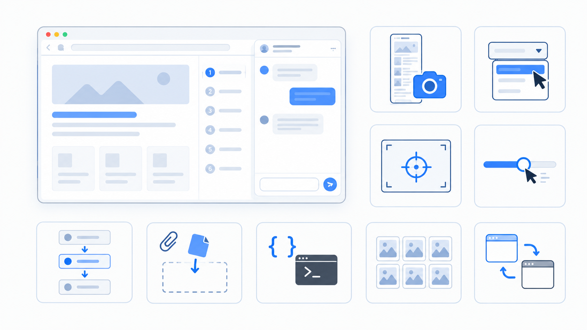
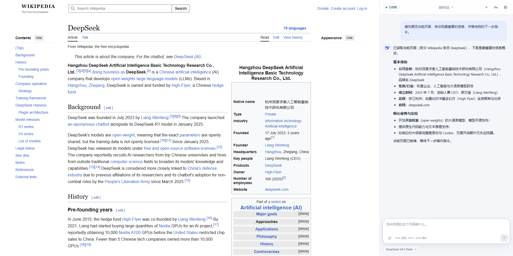
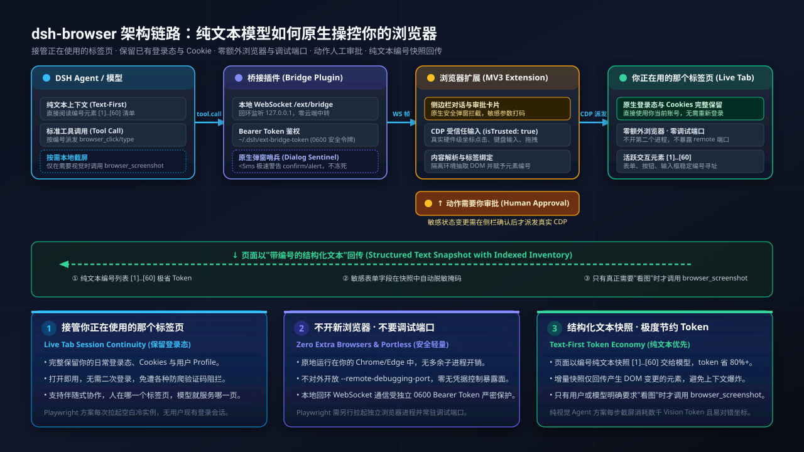

# dsh Browser Control

> [!NOTE]
> **Open the extension side panel and it takes over the page you are browsing right now.**
>
> **This is a fork of [omdsh-dev/dsh-browser](https://github.com/omdsh-dev/dsh-browser)** that fills in what upstream lacks: viewport and whole-page `browser_screenshot`, `browser_hover`, `browser_click_at`, `browser_drag`, `browser_batch`, `browser_eval`, `browser_upload`, and `browser_images`. Its bridge package is `@dightendless/dsh-bridge-browser` — a name of its own, so this fork and the upstream package can sit in one dsh profile without replacing each other.

**English** | [中文](README.zh.md)

[](https://www.npmjs.com/package/@dightendless/dsh-bridge-browser)





<p align="center">
  
</p>

Connect [DeepSeek Harness](https://github.com/deepseek-ai/deepseek-harness) to the Chrome or Firefox tabs you are already using. The model can read page content, operate controls, navigate, and manage tabs while preserving your login state, session, and cookies. A side panel or sidebar provides the conversation UI.

`dsh` is DeepSeek AI's open-source, plugin-based agent harness. This repository provides a companion browser bridge plugin and Chrome/Firefox MV3 extension as one standalone pnpm workspace.

Browser operation is text-first: pages become structured text with a numbered inventory of interactive elements, and the model addresses those elements by number. `browser_screenshot` is the one tool that returns an image—it saves the capture to a local file and hands the model that path, so the page channel keeps its text shape. dsh 0.2.0 multimodal chat is a separate channel again: the side panel accepts PNG, JPEG, WebP, and GIF attachments when the host advertises image support.

> [!IMPORTANT]
> The workspace pins dsh 0.2.0-rc.2 as its minimum supported runtime, and the published package accepts the `0.2.1-alpha` line as well — `0.2.1-alpha.1` included, which is the build the plugin marketplace verifies against. Older DSH releases are not supported.

## Quick install

Three routes. The integration contains both a dsh bridge plugin and a browser extension, and the extension half is always loaded unpacked in Chrome, which allows no other way — so unless you use the installer, the two halves are installed separately.

**1. Plugin only**, prebuilt, with no build step and no Git:

```sh
dsh plugin --profile web add https://github.com/DightEndless/dsh-browser/releases/download/v0.3.5/dightendless-dsh-bridge-browser-0.3.5.tgz
```

The same package is on npm, and the CLI takes it straight from there:

```sh
dsh plugin --profile web add @dightendless/dsh-bridge-browser
```

(`npm i @dightendless/dsh-bridge-browser` if you manage the profile by hand instead. After installing the plugin, open the panel and follow the instructions to load the extension.)

**2. Extension only**, prebuilt: download
[`dsh-browser-extension-0.3.5.zip`](https://github.com/DightEndless/dsh-browser/releases/download/v0.3.5/dsh-browser-extension-0.3.5.zip),
unzip it, then open `chrome://extensions` (Edge: `edge://extensions`), turn on **Developer mode**, choose **Load unpacked**, and select the folder that came out of the zip.

Routes 1 and 2 together are the whole product, and neither needs Node, pnpm, or Git.

**3. Both halves**, through the one-line installer, which builds and registers the bridge plugin, builds the Chrome extension into `~/.dsh/browser-extension`, and opens `chrome://extensions`:

macOS and Linux:

```sh
curl -fsSL https://raw.githubusercontent.com/DightEndless/dsh-browser/refs/heads/main/scripts/install.sh | bash
```

Windows, in PowerShell:

```powershell
$s="$env:TEMP\dsh-install.ps1"; irm https://raw.githubusercontent.com/DightEndless/dsh-browser/refs/heads/main/scripts/install.ps1 -OutFile $s; powershell -NoProfile -ExecutionPolicy Bypass -File $s
```

This route needs Node.js 22+ and pnpm, because it builds both halves from source.

Whichever route you take, load or reload **dsh Browser Assistant** on the browser's extension page, and restart dsh if it is already running. See [Detailed installation and usage](#detailed-installation-and-usage) for prerequisites, startup commands, updates, and developer installation.

Installing the plugin from repository source also works — `dsh plugin --profile web add github:DightEndless/dsh-browser#path:/packages/browser/bridge-browser` — but that package builds itself on install, and pnpm refuses to run build scripts for a git-hosted package until it is allowlisted, so this route needs a manual `allowBuilds` entry first. The release assets above need none, because they ship already built.

> [!IMPORTANT]
> The unscoped [`dsh-browser`](https://www.npmjs.com/package/dsh-browser) package on npm belongs to a different project and is not affiliated with this repository. This fork is not published on npm either: the prebuilt release assets above are the install, and the installer is the one-command alternative.

## How this differs from Playwright-based approaches

Most browser-automation agent stacks rely on headless Playwright or Puppeteer. While effective for automated testing, running an interactive personal agent with that architecture creates distinct trade-offs:

1. **Active Tab vs. Cold Browser**: Playwright launches an isolated, blank browser instance with an empty cache. `dsh-browser` attaches directly to the Chrome or Edge tab you are already browsing in, so existing logins, cookies, session credentials, and user profiles remain instantly available without manual re-authentication or credentials sharing.
2. **Zero Extra Processes or Debugging Ports**: Instead of spawning background browser processes with an open `--remote-debugging-port` (which exposes an unauthenticated control surface), `dsh-browser` operates via an unpacked MV3 extension communicating with the host over a local, bearer-token-authenticated loopback WebSocket.
3. **Approval-Gated, Trusted Input**: While Playwright runs scripted events in an unattended loop, `dsh-browser` gates state-changing actions behind explicit user approval in the side panel. While `browser_click` uses content script `el.click()` (synthetic event), coordinate clicks (`browser_click_at`), keyboard input (`browser_press`/`browser_type`), and drag/upload dispatch genuine CDP events (`isTrusted: true`) that modern web applications accept, while sensitive form values are masked in snapshots.

## Performance


In a paired 60-run end-to-end benchmark on August 18, 2026, measured on the upstream project whose page-tool surface this fork shares, both backends completed all 30 assigned runs successfully, while dsh Browser Control required fewer model/tool round trips and finished faster:

| Backend | Success | Mean end-to-end latency | Mean browser tool calls |
|---|---:|---:|---:|
| **dsh Browser Control** | **30/30** | **5.32 s** | **3.4** |
| Matched Playwright baseline | 30/30 | 6.67 s | 4.7 |

The paired Playwright / extension duration ratio was **1.24** (95% CI **1.16–1.34**): Playwright took about 24% longer, or equivalently, dsh Browser Control reduced latency by about 20% and saved 1.35 seconds per task on average. The suite used six browser tasks, five deterministic seeds, the same DSH profile and model (`deepseek-v4-flash`), and independently validated page state. See the [benchmark methodology and reproduction guide](benchmark/README.md).

## Core capabilities

| Capability | Tool | Notes |
|---|---|---|
| Read page | `browser_snapshot` | Structured text snapshot: title, URL, main text, numbered controls, and masked form fields; `delta: true` returns only changes |
| Click element | `browser_click` | Click links, buttons, checkboxes, and other controls by inventory number |
| Click a point | `browser_click_at` | Click a viewport position with trusted mouse input; `x`/`y` are fractions of the viewport |
| Fill forms | `browser_type` | React/Vue-compatible input; picks a `<select>` option by its label or value and toggles checkboxes/radios; `replace` clears the field first |
| Upload a file | `browser_upload` | Attach a local file to a file input by path; the approval prompt names the file |
| Run script | `browser_eval` | Evaluate a JavaScript expression in the page through the DevTools protocol and return its value; needs the `debugger` permission |
| Press keys | `browser_press` | Enter, Tab, Escape, arrows etc. Tab moves focus and Enter/Space run the page's default action |
| Scroll | `browser_scroll` | Viewport scrolling: up, down, top, and bottom |
| Navigate | `browser_navigate` / `browser_open_tab` / `browser_back` / `browser_forward` / `browser_reload` | Navigation inside the controlled tab, or open a URL in a new tab and follow it (`active:false` keeps the current tab in front) |
| List tabs | `browser_list_tabs` | List accessible tabs with stable IDs, titles, URLs, window/index metadata, and active/controlled state |
| Follow tab | `browser_follow_tab` | Bind later browser tools to a tab returned by `browser_list_tabs` without activating it |
| Close tab | `browser_close_tab` | Close a tab returned by `browser_list_tabs` |
| Read region | `browser_get_text` | Lazy-loaded or partial page text |
| List images | `browser_images` | Absolute image URLs from the main content region, one per line, with dimensions, alt text, and lazy/placeholder flags; resolves `zoomfile`/`file`/`data-src` channels, and takes `selector`, `limit`, `allFrames` |
| Capture the view | `browser_screenshot` | Save the visible area as a local image and return its path for `read_image`; use it for visual content (captcha, chart, layout) or images `browser_images` cannot reach |
| Wait | `browser_wait` | Page settle detection, or wait for a `selector`/`text` to appear — or to disappear with `gone` — within `timeoutMs` |
| Send images | `session.prompt` / `session.attachment` | Host-capability-gated image drafts, image-only prompts, and durable history previews |
| Quote a selection | side panel composer | Text you highlight in the page appears in the composer and is sent with your next message as fenced, attributed page content |

## Repository layout

```
packages/browser/bridge-browser/
  cordis.patch.yml
extensions/dsh-browser/
scripts/install.sh
scripts/install.ps1
```

## Why this design

- **Your real browser, not a headless copy**: the model works in the page you already have open, retaining logins, sessions, and cookies.
- **A text-first page interface**: numbered controls, stable IDs across snapshots, delta updates, and masked sensitive values make pages operable without screenshots; user-attached chat images use dsh's separate multimodal message path.
- **Pointing instead of describing**: highlight the passage you mean and the side panel quotes it, so "explain this" needs no page tour. The quote is captured only while a panel is open, and nothing is sent until you send the message.
- **A narrow privacy boundary**: passwords and payment-card values are always rendered as `••••` and never leave the page.
- **A guarded bridge**: authenticated handshakes protect remote connections, privileged gateway methods reject non-loopback callers, and the extension binds tools to one user-controlled tab.

## Detailed installation and usage

Requirements: Node.js `^22.19` or `>=24`, Corepack/pnpm, and Chrome 116+ or Firefox 140+. Windows additionally needs Windows PowerShell 5.1, which ships with Windows, or PowerShell 7+.

### Install or update

For a managed installation, run:

```sh
curl -fsSL https://raw.githubusercontent.com/DightEndless/dsh-browser/refs/heads/main/scripts/install.sh | bash
```

or, on Windows:

```powershell
$s="$env:TEMP\dsh-install.ps1"; irm https://raw.githubusercontent.com/DightEndless/dsh-browser/refs/heads/main/scripts/install.ps1 -OutFile $s; powershell -NoProfile -ExecutionPolicy Bypass -File $s
```

The installer downloads this repository's default branch, builds and registers the bridge plugin, builds the Chrome extension into `~/.dsh/browser-extension`, and opens `chrome://extensions`. On the first install, load that directory as an unpacked extension; on updates, click **Reload**. Restart dsh if it is already running.

`scripts/install.sh` covers macOS and Linux, and `scripts/install.ps1` covers Windows; both write the same managed workspace and the same install metadata. The installer copies the extension path to the clipboard when a clipboard tool is available (`pbcopy`, `wl-copy`, `xclip`, `xsel`, or PowerShell's `Set-Clipboard`), and prints the path either way. When no Chrome or Chromium install is found, it prints the command that installs one; set `DSH_INSTALL_BROWSER=1` to let the installer attempt that install itself.

The Windows command downloads `install.ps1` and runs it rather than piping it into `Invoke-Expression`: the script is UTF-8 with a byte order mark so Windows PowerShell renders its Chinese output, and `Invoke-Expression` rejects a leading mark. Local checkout paths may contain spaces; the installer registers the bridge through a profile-local directory junction so the package spec never contains the absolute Windows path.

To install the current branch from a source checkout instead:

```sh
git clone https://github.com/DightEndless/dsh-browser.git
cd dsh-browser
./scripts/install.sh
```

On Windows, run `.\scripts\install.ps1` from the checkout instead. After pulling or switching revisions, rerun the installer and reload the extension.

### Firefox source build

Firefox uses a separate MV3 manifest, event-page background, and sidebar. Build it from a checkout, then open `about:debugging#/runtime/this-firefox`, choose **Load Temporary Add-on**, and select `extensions/dsh-browser/dist-firefox/manifest.json`:

```sh
pnpm install
pnpm --filter dsh-browser-extension run build:firefox
```

The bridge address is still auto-discovered. Firefox's `moz-extension://` UUID does not authenticate an add-on, so copy the bearer token from `~/.dsh/ext-bridge-token` into the extension settings (the dsh startup log reports that file's path). Signed distribution can package the same `dist-firefox/` output.

### Start and use

Start the managed installation with:

```sh
cd ~/.dsh/dsh-browser && pnpm start
```

From a source checkout, run `pnpm start` in the repository root. The exact supported public runtime is:

```sh
npx @deepseek-ai/dsh@0.2.0-rc.2 web
```

Local Chrome use requires no configuration; Firefox requires the local bridge token described above. Open a page, click the DeepSeek whale icon, and wait for **Connected**. Existing HTTP(S) tabs are instrumented on the first action. On browser-protected pages and extension stores, the model can read tab metadata and use browser-level HTTP(S) navigation, back, forward, and reload, but it cannot inspect or operate the protected page DOM.

## Troubleshooting

**Side panel stays "Not connected"**

- Make sure dsh web is running locally (default `http://127.0.0.1:3080`).
- Verify the bridge is loaded: open `http://127.0.0.1:3080/ext/bridge-config`. It should return JSON such as `{"wsUrl":"ws://127.0.0.1:3080/ext/bridge"}`. If it returns a web page instead of JSON, the running dsh predates the bridge registration — restart dsh and refresh the page; the extension reconnects on its own.
- The extension probes ports 3080, 3081, 3090, and 14389 automatically. If dsh runs on another port — or you use a remote `--host 0.0.0.0` deployment — set the address (and bridge token) in the panel settings. Firefox always requires the token.

## Development

The bridge plugin and Chrome/Firefox extension are both members of this repository's workspace. Run all commands from the repository root. For the first development installation, run `pnpm install`.

```sh
pnpm run build
pnpm run typecheck
pnpm run test
pnpm run check:runtime
pnpm run test:smoke

pnpm --filter @dightendless/dsh-bridge-browser run build
pnpm --filter @dightendless/dsh-bridge-browser run typecheck
pnpm --filter @dightendless/dsh-bridge-browser run test

pnpm --filter dsh-browser-extension run build
pnpm --filter dsh-browser-extension run build:firefox
pnpm --filter dsh-browser-extension run test
```

Notes:

- The bridge plugin must have a built `lib/` before startup because the loader consumes it; both `scripts/install.sh` and the root `pnpm run build` build the plugin before the extension.
- The bridge build copies its browser client with Node.js `copyFileSync`, so the same package script works without a Unix `cp` executable.
- The dependencies of `@deepseek-ai/dsh` and the bridge plugin are pinned to the same tested public release line. An upgrade must update the manifests and lockfile together and rerun the root checks.

`check:runtime` checks the resolved DSH dependencies and lockfile; `test:smoke` starts the real web host in a temporary DSH home and verifies the bridge and session reads after a restart, without model credentials. CI runs these checks after a clean installation.

If you encounter `cache.hydratePrepared is not a function`, update the repository, rerun `pnpm install --frozen-lockfile` and `pnpm run build`, then restart `pnpm start`. Session data and the global package cache can be kept.

## Security

- The bridge path sits outside the `/api` trust boundary and performs its own bearer-token authentication.
- Local Chrome extension origins retain zero-configuration loopback access; Firefox origins are per-install UUIDs and must present the bearer token.
- Privileged gateway methods such as `settings.*`, `credentials.*`, and `host.open*` reject non-loopback sources.
- The browser-page pipeline is structured text by default, and `browser_screenshot` is the one browser tool that returns an image: the capture goes to a local file and the model is given that path, never the pixels inline. Explicitly attached chat images use dsh's durable attachment service. Password and payment-card values never leave the page.
- When work begins, the assistant binds to the active tab (at prompt submission, or at the first direct browser-tool call). If you switch tabs manually, later browser actions pause and the side panel asks whether the assistant should continue on the original tab or follow the new one. Choosing the original tab permits background operation; the extension never silently retargets or changes your visible tab. Closing the controlled tab also pauses tools until you explicitly select the current page.
- Text you highlight is captured only while a side panel is open and page sharing is not `off`, and never from password or payment-card fields. It stays inside the extension until you send the message, is dropped when you dismiss it or its page navigates or closes, and reaches the model inside the same untrusted-content boundary as page snapshots — including its source title and URL, which the page also controls.
- Page-authored text is wrapped as untrusted input. The default `auto` mode reads only the controlled tab without an extra prompt; privacy-sensitive users can select `ask` for per-read confirmation or `off` to block reads entirely. In `ask` mode, the read dialog can allow one read or persistently switch back to `auto`; this can be reversed in Settings. Read page text is sent to the selected model.
- Click, type, keypress, navigation, history, and reload calls fail closed until the user approves them. An origin may be trusted for the current side-panel session (cleared when the last panel closes or the service worker restarts), while permanent trust is managed explicitly in Settings. Explicit cross-origin `browser_navigate` calls and unknown history destinations always prompt again.
- **Allow unrestricted browser control** is an explicit global opt-in. It becomes active only after the setting is saved successfully; while enabled, page reads, page actions, and tab list/follow/close operations run without approval prompts. Calls capture their access mode when received, so enabling unrestricted control never retroactively elevates an existing restricted call. Disabling it takes effect immediately, cancels calls that have not dispatched an action, waits for already-dispatched browser operations to settle, and only then saves the restrictive setting. A rapid re-enable remains restricted until that revocation finishes, and concurrent saves persist in request order. Browser-protected DOM content remains inaccessible in either mode.
